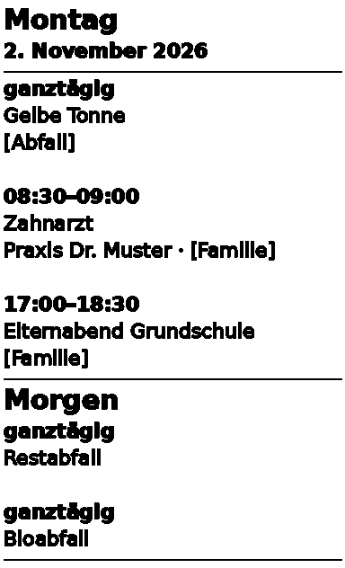

# Phomemo T02 Mini-Drucker für Home Assistant

[](https://hacs.xyz)

Eigene Integration für den kleinen Thermodrucker **T02** (Phomemo und baugleiche Nachbauten,
53-mm-Papier). Druckt jeden Morgen deine Termine, Abfuhrtermine, freien Text oder Bilder.
Akkustand und Papierstatus werden als Sensoren angezeigt. Alles läuft lokal über Bluetooth,
ohne App und ohne Cloud.



## Funktionen

- **Kalender drucken:** Termine eines Tages aus einem oder mehreren Kalendern, sortiert und mit Ort
- **Vorschau „Morgen“:** z. B. die Abfuhr von morgen, damit die Tonne abends rauskommt
- **Text drucken:** mit Überschrift (`# …`), Fettdruck (`**…**`) und Linien (`---`)
- **Bild drucken:** PNG/JPG, automatisch auf Druckbreite gerastert
- **Sensoren:** Akku in %, „Papier fehlt“, Firmware und Seriennummer in den Geräteinfos
- **Einrichtung per Klick:** Der Drucker wird automatisch per Bluetooth gefunden

---

## 1. Voraussetzungen

| Was | Hinweis |
|---|---|
| Home Assistant | ab Version 2024.10 |
| Drucker | T02 (Phomemo oder Nachbau), Bluetooth-Name beginnt mit „T02“ |
| Bluetooth | **ESPHome-Bluetooth-Proxy empfohlen**, siehe unten |
| Kalender | jeder Kalender in Home Assistant (Google, CalDAV, iCal/ICS, lokal …) |

### Bluetooth: Warum ein ESPHome-Proxy?

Manche T02 brechen Verbindungen über den eingebauten Bluetooth-Adapter des Home-Assistant-Rechners
nach Sekundenbruchteilen ab. Über einen **ESP32 mit ESPHome-Bluetooth-Proxy** laufen sie stabil.
Die Integration nimmt deshalb automatisch zuerst einen Proxy, wenn einer den Drucker sieht.

Einen Proxy einrichten: Auf <https://esphome.github.io/bluetooth-proxies/> einen ESP32 im Browser
flashen. Das dauert etwa 5 Minuten. Die offiziellen Vorlagen erlauben aktive Verbindungen bereits.
Bei einer eigenen Konfiguration muss diese Zeile drin sein:

```yaml
bluetooth_proxy:
  active: true
```

**Reichweite:** Der Drucker sollte nicht weiter als ein paar Meter vom Proxy entfernt stehen.

| Signalstärke (RSSI) | Ergebnis |
|---|---|
| besser als −80 | zuverlässig |
| −80 bis −88 | klappt meistens |
| schlechter als −88 | Abbrüche, Statusabfragen ohne Antwort |

Den aktuellen Wert findest du unter *Einstellungen → Geräte & Dienste → Bluetooth →
Werbeüberwachung*, wenn du nach der MAC-Adresse des Druckers suchst.

---

## 2. Installation

### Variante A: über HACS (empfohlen)

[](https://my.home-assistant.io/redirect/hacs_repository/?owner=frifreu&repository=ha-phomemo-t02&category=integration)

Oder von Hand:

1. *HACS → ⋮ → Benutzerdefinierte Repositories*
2. `https://github.com/frifreu/ha-phomemo-t02` eintragen, Typ **Integration**, *Hinzufügen*
3. **Phomemo T02 Mini-Drucker** suchen und herunterladen
4. Home Assistant **neu starten**

Neue Stände auf GitHub zeigt HACS automatisch als Update an (sofort über *HACS → ⋮ → Nach Updates suchen*).

### Variante B: manuell aus der ZIP-Datei

Die ZIP-Datei gibt es auf GitHub unter **Code → Download ZIP** (Ordner heißt dann
`ha-phomemo-t02-main`).

Der Ordner `custom_components/phomemo_t02` muss nach `/config/custom_components/phomemo_t02`.
Am einfachsten geht das so:

1. Das Add-on **Terminal & SSH** installieren, falls es noch fehlt
   (*Einstellungen → Add-ons → Add-on Store*).
2. Mit dem Add-on **File editor** die ZIP-Datei nach `/config` hochladen.
3. Im Terminal:
    ```bash
    cd /config
    unzip -o ha-phomemo-t02-main.zip
    mkdir -p custom_components
    cp -r ha-phomemo-t02-main/custom_components/phomemo_t02 custom_components/
    rm -rf ha-phomemo-t02-main ha-phomemo-t02-main.zip
    ```
4. Home Assistant **neu starten**.

Ohne Terminal geht es mit dem Add-on **Studio Code Server** oder einer **Samba**-Freigabe.
Dort kannst du den ganzen Ordner einfach hineinziehen.

---

## 3. Drucker einrichten

1. Drucker einschalten und in die Nähe des Proxys stellen.
2. *Einstellungen → Geräte & Dienste*: Meist erscheint der Drucker oben als **Entdeckt**.
   Dann einfach auf **Hinzufügen** klicken.
3. Falls nicht: *Integration hinzufügen → „Phomemo T02“*, dann den Drucker aus der Liste wählen
   oder die MAC-Adresse eingeben.
4. Testdruck unter *Entwicklerwerkzeuge → Aktionen* (YAML-Modus):
    ```yaml
    action: phomemo_t02.print_text
    data:
      text: "# Hallo\nDer Drucker läuft."
    ```

Nach der Einrichtung gibt es das Gerät **T02** mit diesen Entitäten:

| Entität | Bedeutung |
|---|---|
| `sensor.t02_akku` | Akkustand in %; Attribute `erreichbar` und `zuletzt_gelesen` |
| `binary_sensor.t02_papier_fehlt` | „Problem“, wenn keine Rolle eingelegt ist |

Der Status wird beim Start, **alle 6 Stunden** und **nach jedem Druck** gelesen, sofort mit
`phomemo_t02.update_status`. Ist der Drucker aus, bleiben die letzten Werte stehen.

> Heißt dein Drucker anders als „T02“, ändern sich auch die Entitäts-IDs entsprechend.

---

## 4. Morgendruck einrichten

Die fertige Vorlage liegt in `examples/morgendruck_termine.yaml`.

1. In `configuration.yaml` Packages aktivieren, falls noch nicht geschehen:
    ```yaml
    homeassistant:
      packages: !include_dir_named packages
    ```
2. Die Datei nach `/config/packages/` kopieren.
3. Die **eigenen Kalender** eintragen. Die Namen findest du unter *Einstellungen → Geräte & Dienste →
   Entitäten*, wenn du nach `calendar.` suchst.
4. Die Uhrzeit anpassen (Standard 06:30).
5. Home Assistant neu starten (oder *YAML → Alles neu laden*).
6. `input_boolean.morgendruck_aktiv` einschalten.
7. Mit dem Skript **Termine jetzt drucken** testen.

**Tipp für den Abfallkalender:** Die Tonnen müssen oft schon vor 6 Uhr draußen stehen. Trag den
Abfallkalender deshalb zusätzlich unter `preview_entity_id` ein. Dann steht auf dem Zettel ein
Abschnitt **„Morgen“** mit der nächsten Abfuhr.

**Tipp zur Stromversorgung:** Der T02 schaltet sich nach einiger Zeit ab. Für den Morgendruck sollte
er am USB-Ladekabel hängen und eingeschaltet bleiben.

### Warnungen (optional)

`examples/drucker_warnungen.yaml` schickt eine Handy-Benachrichtigung bei Akku unter 20 % oder
leerem Papier und frischt den Status um 06:15 auf. Darin `notify.mobile_app_mein_handy` durch den
eigenen Benachrichtigungsdienst ersetzen.

---

## 5. Alle Aktionen

### `phomemo_t02.print_calendar`: Termine drucken

| Feld | Standard | Bedeutung |
|---|---|---|
| `entity_id` | – | ein oder mehrere Kalender (Pflicht) |
| `day_offset` | `0` | 0 = heute, 1 = morgen … |
| `preview_entity_id` | – | Kalender, deren nächste Tage zusätzlich gedruckt werden |
| `preview_days` | `1` | Tage der Vorschau (1 = „Morgen“, mehr = „Demnächst“) |
| `show_location` | `true` | Ort unter dem Termin anzeigen |
| `skip_if_empty` | `false` | ohne Termine gar nicht drucken |
| `font_size` | `22` | Schriftgröße in Pixeln |

Termine, die nicht genau auf den gedruckten Tag fallen (mehrtägig, Vorschau), bekommen ihr Datum
dazu, z. B. „Di 03.11. ganztägig“. Bei mehreren Kalendern steht der Kalendername in Klammern dahinter.

### `phomemo_t02.print_text`: Text drucken

```yaml
action: phomemo_t02.print_text
data:
  text: |
    # Einkaufsliste
    **Wochenmarkt**
    - Äpfel
    - Brot
    ---
    Stand: {{ now().strftime('%d.%m. %H:%M') }}
```

| Zeile beginnt mit | Wirkung |
|---|---|
| `# ` | große fette Überschrift |
| `**…**` (ganze Zeile) | fett |
| `---` | Trennlinie |

### `phomemo_t02.print_image`: Bild drucken

```yaml
action: phomemo_t02.print_image
data:
  path: /config/www/bild.png
```

| Feld | Standard | Bedeutung |
|---|---|---|
| `rotate` | `auto` | `auto` dreht Querformat um 90° (größerer Druck), `always`, `never` |
| `dither` | `atkinson` | `atkinson` für Fotos, `floyd` feiner/dunkler, `none` für Grafiken und Text |

Fotos werden automatisch aufgehellt und nachgeschärft, damit Gesichter im Punktraster erkennbar bleiben.

Ordner außerhalb von `/config/www` müssen in `configuration.yaml` unter
`homeassistant: allowlist_external_dirs:` freigegeben sein.

Statt `path` geht auch `url` (Bild aus dem Netz, z. B. ein Kamerabild) oder `image_base64`
(Bilddaten als Text, z. B. von einem iPhone-Kurzbefehl).

### Vom iPhone drucken (Kurzbefehl)

So lassen sich Fotos direkt aus der Fotos-App über *Teilen → „Auf T02 drucken“* drucken:

1. In Home Assistant: *Profil → Sicherheit → Langlebige Zugriffstoken → Token erstellen*, den Token kopieren.
2. In der App **Kurzbefehle** einen neuen Kurzbefehl „Auf T02 drucken“ anlegen. Unter *Details* den
   Schalter „Im Share-Sheet anzeigen“ einschalten, Eingabe: **Bilder**.
3. Aktionen in dieser Reihenfolge:
    - **Bildgröße ändern:** Breite 800
    - **Bild konvertieren:** in JPEG
    - **Base64-codieren:** Kurzbefehleingabe bzw. konvertiertes Bild
    - **Inhalte von URL abrufen:** `http://<HA-Adresse>:8123/api/services/phomemo_t02/print_image`,
      Methode **POST**, Header `Authorization` = `Bearer <Token>`, Hauptteil **JSON** mit dem Feld
      `image_base64` (Text) = *Base64-codiertes Ergebnis*
4. Testen: Foto öffnen, *Teilen → Auf T02 drucken*.

Unterwegs funktioniert das nur, wenn Home Assistant von außen erreichbar ist (z. B. Nabu Casa).
Den Token wie ein Passwort behandeln.

### Weitere

| Aktion | Zweck |
|---|---|
| `phomemo_t02.update_status` | Akku und Papier sofort lesen |
| `phomemo_t02.feed` | Papiervorschub (`lines`: Pixelzeilen, 8 = 1 mm) |
| `phomemo_t02.density_test` | Probestreifen mit verschiedenen Druckdichten |

**Gemeinsame Felder** für die Druck-Aktionen:

| Feld | Standard | Bedeutung |
|---|---|---|
| `density` | `4` | Druckdichte/Hitze (1 = blass; bei vielen T02 ist ab 2 Schluss) |
| `stroke` | `1` | Schrift kräftiger: 0 = dünn, 1 = kräftig, 2 = sehr fett |
| `printer` | – | nur bei mehreren Druckern: Name oder MAC-Adresse |

---

## 6. Fehlersuche

| Meldung / Problem | Ursache und Abhilfe |
|---|---|
| „nicht in Reichweite oder ausgeschaltet“ | Drucker an? Kein Proxy oder Adapter sieht ihn. Näher an den Proxy stellen. |
| „keine Verbindung – Signal sehr schwach“ | RSSI zu schlecht, siehe Tabelle in Abschnitt 1 |
| „Error 128“ / Proxy hängt | ESPHome-Proxy neu starten, Drucker aus- und einschalten |
| Akku/Papier zeigen „unbekannt“ | Seit dem Neustart noch keine erfolgreiche Abfrage: `update_status` ausführen |
| Ausdruck blass | Papier richtig herum? (beschichtete Seite zum Druckkopf); `stroke: 1` oder `2` |
| Ausdruck bricht mittendrin ab | Signal zu schwach; sonst in `const.py` `CHUNK_DELAY` erhöhen (z. B. `0.08`) |
| Abfuhr erscheint am falschen Tag | Kalendertermin prüfen: `calendar.get_events` unter *Entwicklerwerkzeuge* |

**Ausführliches Protokoll** einschalten (in `configuration.yaml`, danach neu starten):

```yaml
logger:
  default: warning
  logs:
    custom_components.phomemo_t02: debug
```

Die Einträge findest du unter *Einstellungen → System → Protokolle → ⋮ → Vollständige
Protokolle anzeigen*, wenn du nach `phomemo` suchst.

---

## 7. Technische Details

- Bluetooth LE, Dienst `ff00`; Daten an `ff02`, Statusmeldungen über `ff03`
- Raster 384 Punkte breit (48 mm bei 203 dpi), ESC/POS `GS v 0` mit Phomemo-Erweiterungen
- Statusabfragen `1f 11 xx` → Antwort `1a <typ> <wert>` (04 Akku, 06 Papier, 07 Firmware, 08 Seriennummer)
- Getestet mit einem T02-Nachbau (Firmware 3.2.10) über einen ESP32-Bluetooth-Proxy

## Danksagung und Lizenzen

- Protokoll-Grundlagen: [vivier/phomemo-tools](https://github.com/vivier/phomemo-tools)
- Mitgelieferte Schrift: DejaVu Sans, freie Lizenz (siehe `custom_components/phomemo_t02/fonts/LICENSE-DejaVu.txt`)
- Lizenz: MIT (siehe `LICENSE`)
- Kein offizielles Produkt von Phomemo. Nutzung auf eigene Verantwortung.
- Fehler und Wünsche bitte als [Issue](https://github.com/frifreu/ha-phomemo-t02/issues) melden.
